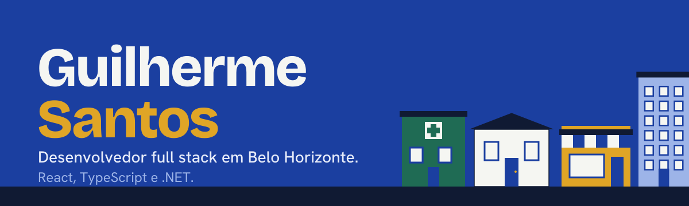
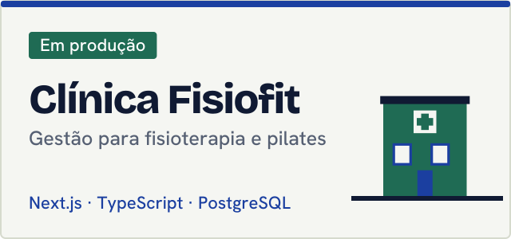
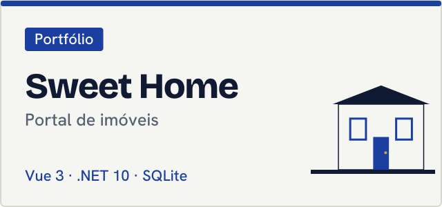

  

Construo sistemas completos, da modelagem do banco à tela que alguém usa todo dia. Trabalho como desenvolvedor na NIC Labs, estudo Engenharia de Software e sou técnico em Desenvolvimento de Sistemas. Gosto de projetos com usuários reais, porque é aí que arquitetura, testes e documentação deixam de ser teoria.

## Em destaque

<table>
  <tr>
    <td width="50%" valign="top">
      
      
Gestão de uma clínica de fisioterapia e pilates com mais de uma unidade: pacientes, planos, pagamentos, agenda e unidades, mais o site institucional.

      
Tem CI com testes automatizados, backup criptografado do banco com teste de restauração e cuidado com dados pessoais (LGPD). Repositório privado.

    </td>
    <td width="50%" valign="top">
      
      
Portal de imóveis completo: busca com filtros, anúncios com várias fotos, cadastro e login, precificador, contato com o anunciante e painel do administrador.

      
Front em Vue 3 com design system próprio, API em .NET 10 e SQLite. Roda local com um clique. Código em breve.

    </td>
  </tr>
</table>

## Outros projetos

| Projeto | O que é | Tecnologias |
| --- | --- | --- |
| [Life OS](https://github.com/guilhermesantossousadev/Life-Os) | App pessoal para tarefas, agenda, metas, projetos, notas e finanças. Clean Architecture, autenticação, testes e Docker. | React 19, TypeScript, ASP.NET Core, PostgreSQL, Supabase |
| [Jana Modas](https://github.com/guilhermesantossousadev/JanaModasSystem) ([demo](https://jana-modas-system.vercel.app)) | Mini-ERP de uma loja de roupas: clientes, estoque por grade, vendas e fluxo de caixa. | Next.js, TypeScript, Supabase |
| Automações NIC Labs | Fluxos de agenda, gestão de capacidade e processamento de documentos. Repositório privado. | n8n, Google Apps Script, Node.js, OpenAI |
| [JuniorDevAssessment](https://github.com/guilhermesantossousadev/JuniorDevAssessment) | Avaliação técnica: API, persistência e integração com o front. | .NET, SQLite, Vue |

## Com o que eu trabalho

**Front-end:** React, TypeScript, Vue, Vite, HTML e CSS  
**Back-end:** C# e ASP.NET Core, Java e Spring Boot, Node.js, Python  
**Dados e infraestrutura:** PostgreSQL, MySQL, SQLite, Supabase, Docker, GitHub Actions  
**Automação:** n8n, Google Apps Script, integrações com APIs e bots do Discord

## Estudando agora

Arquitetura e separação de responsabilidades entre camadas, testes automatizados, pipelines de deploy e documentação de decisões técnicas.

## Contato

[guilhermessousa.dev@gmail.com](mailto:guilhermessousa.dev@gmail.com) · [LinkedIn](https://www.linkedin.com/in/guilherme-santos-sousa-dev)
